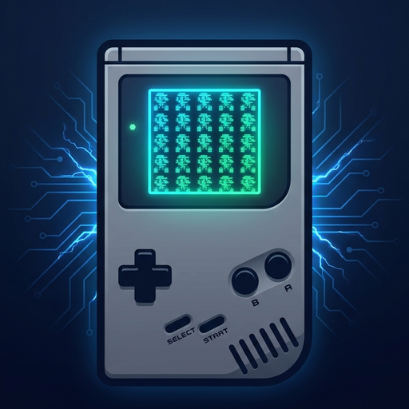

<p align="center">
  
</p>

<h1 align="center">PS4 GB-JIT</h1>

<p align="center">
  <strong>Native Game Boy (DMG-01) Dynamic Recompiler (x86_64 JIT) + HLE Emulator for PlayStation 4 (Orbis OS) & Windows</strong>
</p>

---

## Features

- **Baseline x86_64 Dynamic Recompiler (JIT)**: Compiles SM83 basic blocks directly to native AMD Jaguar (`btver2`) x86_64 machine code in a 4 MiB executable code cache (`GoldHEN RWX mmap` / `sceKernelJitCreateSharedMemory`), with automatic Reference Interpreter fallback.
- **High-Level Emulation (HLE)**:
  - DMG-01 Boot ROM HLE (instant boot, no BIOS file required)
  - Scanline PPU with 4 classic DMG palettes (`Classic`, `Pocket`, `B&W`, `Amber`) & 7× integer scaling (`1120×1008`) centered on 1080p `sceVideoOut`
  - 4-channel 48 kHz stereo APU on a dedicated 1 MiB stack audio thread (`sceAudioOut`)
  - Full MBC0, MBC1, MBC2, MBC3 (with RTC), and MBC5 cartridge mapper support + battery SRAM (`.sav`) persistence
- **Native 1080p UI & Save States**:
  - Zero-dependency 60 FPS ROM browser, Pause Menu, Settings Modal (toggle `JIT ↔ Interpreter`, cycle palettes, swap A/B), Quick Save/Load (`slot 0`), and `4×` Fast-Forward
  - Built-in **Live Debug HUD** (`L3+R3` / `F12`) showing FPS, active JIT blocks, cache usage, and recent logs
- **Cross-Platform Thin HAL**: Runs natively on **PS4 (OpenOrbis)**, **Windows x64 (`ps4-gb-jit-win64.exe`)**, and **Linux x64** (with ASan/UBSan JIT-vs-Interpreter lockstep & E2E tests in CI).

---

## Installation (PlayStation 4)

1. Download **`PS4-GB-JIT-v01.06.pkg`** from the [Releases](../../releases) page.
2. Install the `.pkg` on your PS4 via GoldHEN Package Installer.
3. Copy your `.gb` ROM files over GoldHEN FTP (`:2121`) into:
   ```text
   /data/gbjit/roms/
   ```
4. Launch **PS4 GB-JIT** from the PS4 home screen (press **Triangle** in the ROM browser to refresh after copying ROMs).

> Saves (`.sav` & `.st0`), settings (`config.ini`), and logs (`log.txt`) are stored in `/data/gbjit/`.

## Installation (Windows PC)

1. Download **`ps4-gb-jit-win64.exe`** from the [Releases](../../releases) page.
2. Run it once to generate `./data/roms/`, drop your `.gb` ROMs inside `./data/roms/`, and press **`R`** to refresh.

---

## Controls

| Action | PlayStation 4 (DualShock 4) | Windows PC (Keyboard) |
| :--- | :--- | :--- |
| **D-Pad** | D-Pad | `Arrow Keys` or `W/A/S/D` |
| **Game Boy A** | `Cross (×)` | `Z` or `J` |
| **Game Boy B** | `Square (□)` | `C` / `X` *(or `K`)* |
| **Game Boy START** | `R1` | `Enter` |
| **Game Boy SELECT** | `Touchpad Click` | `Tab` |
| **Pause Menu** | `Options` | `Esc` |
| **4× Fast-Forward** | Hold `L2` | Hold `Shift` |
| **Quick Save / Load** | `R2` / `L1` | `F5` / `F7` |
| **Live Debug HUD** | `L3 + R3` | `F12` |
| **Refresh ROM List** | `Triangle (△)` *(in Browser)* | `R` |
| **Settings** | `Square (□)` *(in Browser)* | `C` |

---

## Building from Source

### Linux (Tests & `host_run`)
```bash
make lint
make test
make host_run
```

### Windows x64 (CMake + MSVC)
```powershell
cmake -B build-win -A x64
cmake --build build-win --config Release
.\build-win\Release\test_win_jit_selftest.exe
```

### PlayStation 4 (OpenOrbis `v0.5.4`)
```bash
export OO_PS4_TOOLCHAIN=/path/to/OpenOrbis/PS4Toolchain
make ps4
```

---

## Project Layout

```text
src/
├── core/          # GbMachine, MBC0-5 cart, bus, HLE PPU/APU/Timer, SM83 interp, x86_64 JIT
├── debug/         # Structured logger, SCE error decoder, stub discovery, crash handler, self-test
├── hal/           # Platform HAL: ps4/ (OpenOrbis), win/ (Win32+waveOut+XInput), mock/ (Linux CI)
└── ui/            # 1080p write-only bitmap renderer, UI state machine, Live Debug HUD
tests/
├── unit/          # Harness, MBC/HLE, JIT-vs-Interpreter lockstep, Win64 JIT self-test
└── e2e/           # Scripted controller E2E walkthrough
```
