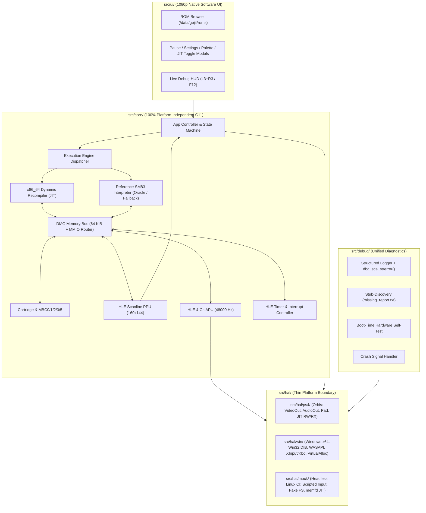

# 01 — Architecture, Data Flow, Memory & Inverted Phase Order

## 1. High-Level Architecture

## 2. Subsystem Data Flow (Per Emulated Frame — 70,224 T-Cycles)
1. **Input Poll**: `hal_input_poll()` reads DS4 (PS4), Keyboard/XInput (Windows), or scripted frame queue (Mock CI) -> updates UI state machine or DMG `JOYP` (`0xFF00`).
2. **Execution Loop (`gb_machine_run_frame`)**:
   - Runs until 70,224 T-cycles (154 scanlines × 456 T-cycles) complete.
   - If `jit_enabled` and `PC < 0x8000` (ROM0/ROMX): lookup `(rom_bank, pc)` in JIT block cache -> compile x86_64 block on miss -> call native x86_64 block via ABI trampoline.
   - If `!jit_enabled` or `PC >= 0x8000` (WRAM/HRAM SMC-safe path): execute via reference SM83 interpreter.
   - Block exit / MMIO helper advances Timer, OAM DMA, Scanline PPU, APU ring buffer, and checks pending interrupts (`IF & IE`).
3. **Video Blit**: PPU outputs `160×144` 2-bit palette indices -> integer-scaled (6× `960×864` or 7× `1120×1008`, centered) into `1920×1080` ARGB8888 backbuffer -> UI / Live Debug HUD composited on top -> `hal_video_present()` flips.
4. **Audio Output**: APU pushes `48000` Hz stereo `int16_t` samples into a lock-free SPSC ring buffer (4096 frames). The dedicated audio thread drains 512-frame grains into blocking `sceAudioOutOutput()` (PS4) / WASAPI (Windows) / silent sink (Mock CI).

## 3. Memory Budgets & Alignment Rules (PS4 Slim — 8 GB GDDR5)
| Allocation | Size | Alignment | PS4 Memory Pool / Protection |
| :--- | :--- | :--- | :--- |
| **Video Framebuffers (×2)** | `2 × 10 MiB` (`20 MiB` total; each `1920×1080×4 = 8.29 MiB` rounded up to `2 MiB` multiple = `10 MiB`) | **`2 MiB` (`0x200000`)** | `sceKernelAllocateDirectMemory` + `MapDirectMemory`, `prot = 0x33` (CPU+GPU R/W) |
| **JIT Code Cache (Dual-Mapped)** | **`4 MiB`** (`0x400000`) | **`16 KiB` (`0x4000`)** | `sceKernelJitCreateSharedMemory(..., 0x07, &rx_fd)` + `Alias(..., 0x03, &rw_fd)` |
| **JIT Block Metadata & Lookup Table** | `~2 MiB` | `16 KiB` (`0x4000`) | FlexibleMemory (`calloc`) |
| **Cartridge ROM Buffer** | Up to `8 MiB` (MBC5 max) | `16 KiB` (`0x4000`) | FlexibleMemory (`malloc`) |
| **Cartridge SRAM + DMG RAM** | `128 KiB` SRAM + `16 KiB` WRAM/VRAM/OAM/HRAM | Default | FlexibleMemory / struct |
| **Audio SPSC Ring Buffer** | `32 KiB` (`4096 × 2 × sizeof(int16_t)`) | `64 B` cacheline | Static / FlexibleMemory |
| **Total Peak Footprint** | **~35 MiB** (< 0.7% of 5 GB app-usable RAM) | — | Zero heap churn inside frame loop |

## 4. Threading & CPU Affinity (PS4 Jaguar — 6 App-Usable Cores `0x3F`)
- **Main Thread (Core 0/1, default 2 MiB stack)**: App lifecycle, UI, JIT/Interpreter emulation loop, PPU scanline rasterizer, 1080p blit, `sceVideoOutSubmitFlip`, `scePadReadState`.
- **Audio Thread (Core 2, explicit `1 MiB` stack — never default `64 KiB`!)**: Drains SPSC ring buffer into blocking `sceAudioOutOutput()` (`512` samples @ `48000` Hz ≈ `10.67 ms` period).
- **Zero other background threads**: Keeps state deterministic, avoids mutex contention, and simplifies TSan verification.

## 5. Inverted Phase Order (Harness First, Features Second, PS4 Last)
1. **Phase 1 — Test & Debug Harness FIRST**:
   - Thin HAL (`src/hal/{win,ps4,mock}/`), `src/debug/` (structured logger + `dbg_sce_strerror()`, Klog tee, Stub-Discovery `missing_report.txt`, Crash Handler, Boot-Time Hardware Self-Test), minimal 1080p boot screen, `scripts/lint.sh`, `scripts/audit_ps4.sh`, and 3-job `.github/workflows/build.yml` (`test-and-lint`, `build-windows`, `build-ps4`).
   - Proves the entire CI + Windows HAL `.exe` + PS4 `.pkg` build/audit pipeline works before writing emulator logic.
2. **Phase 2 — Memory Bus, Cartridge/MBC0-5 & HLE Subsystems**:
   - Boot ROM HLE, Timer, Interrupts, Joypad, Scanline PPU, OAM DMA, 4-ch 48 kHz APU, `.sav`/save-state persistence, with Tier 2 unit tests.
3. **Phase 3 — Reference SM83 Interpreter & Test ROM Suite**:
   - Complete SM83 ISA verified against Blargg `cpu_instrs` / `instr_timing` & `dmg-acid2` in Tier 2 CI (ASan + UBSan).
4. **Phase 4 — Baseline x86_64 Dynamic Recompiler (JIT) + Lockstep Differential Testing**:
   - Dual-mapped RW/RX x86_64 emitter, `(bank, pc)` block cache, SMC invalidation, HLE `HALT`/DMA fast-paths, verified instruction/block-by-block against the Interpreter in Tier 2 CI.
5. **Phase 5 — Lightweight 1080p UI, DS4 Controls & Scripted Active E2E Walkthroughs**:
   - ROM browser (`/data/gbjit/roms/`), pause/settings/palette/JIT-toggle modals, `L3+R3`/`F12` Live Debug HUD, and automated E2E controller walkthroughs in CI.
6. **Phase 6 — Tier 4 Windows PC Interactive Debugging & `shadPS4` Smoke Test**.
7. **Phase 7 — Tier 5 Real PS4 Slim FW 13.52 Batched Hardware Runs** (1–3 batched passes logged in `plan/ps4-runs/`).
