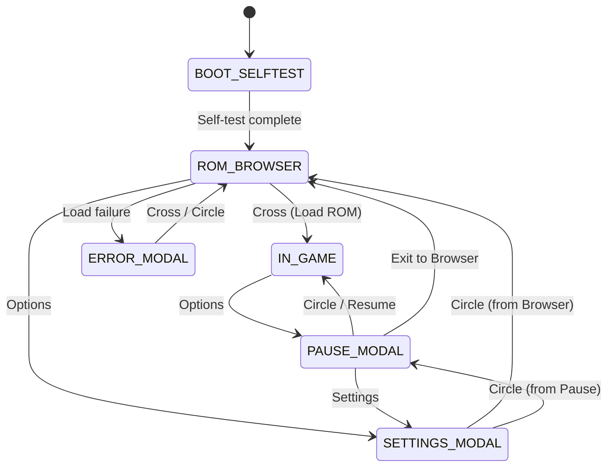

# 03 — Algorithms, JIT Design, UI State Machine & Orbis APIs

## 1. Baseline x86_64 Dynamic Recompiler (JIT) Design

### 1.1 ABI-Safe Register Mapping & Trampoline
To ensure the **exact same x86_64 JIT codegen** runs on Linux x64 (SysV), PS4 Orbis (SysV), and Windows x64 (Win64 ABI), a tiny hand-emitted **JIT Entry Trampoline** saves all callee-saved registers (`rbx, rbp, r12, r13, r14, r15` + `rdi, rsi` on Win64), loads `GbMachine*` into **`RBX`**, and enters the compiled block:
- **`RBX`** (callee-saved on both SysV & Win64): `GbMachine*` pointer (base for all SM83 registers, `cycles_left`, and fast RAM pointers).
- **`R12`** (callee-saved): Cached pointer to `mem->rom0` (`0x0000–0x3FFF`) for fast immediate/ROM reads.
- **`R13`** (callee-saved): Cached pointer to `mem->wram` (`0xC000–0xDFFF`) for fast zero-call WRAM loads/stores.
- **`R14D`** (callee-saved): `cycles_remaining` (signed 32-bit T-cycle budget for current slice).
- **`RAX, RCX, RDX, R8–R11`**: Scratch registers for SM83 ALU ops (`AF, BC, DE, HL, SP`) and C helper calls (`bus_read8`, `bus_write8`).
- **Helper Call Bridge**: Before calling any C helper (`jit_helper_read8`, `jit_helper_write8`, `jit_helper_step_io`), the emitter respects the target platform's calling convention (`#ifdef _WIN32` puts args in `RCX, RDX, R8` with 32-byte shadow space; SysV/PS4 puts args in `RDI, RSI, RDX`), keeping stack 16-byte aligned at every `CALL`.
- **Instruction Set**: Strictly baseline x86_64 (`MOV, ADD, SUB, ADC, SBB, AND, OR, XOR, SHL, SHR, ROL, ROR, BT, CMP, TEST, SETcc, Jcc, CALL, RET`). **Zero AVX2/FMA3/BMI2** instructions.

### 1.2 Dual-Mapped RW/RX Arena & Block Cache
- **Arena**: `4 MiB` (`0x400000`, `16 KiB` aligned) allocated via `hal_jit_alloc(&rx_base, &rw_base, size)`.
  - Emit bytes into `rw_base + write_cursor`.
  - Store executable entry point `rx_base + block_offset` in the block table.
  - All internal branches within a block use relative `rel8`/`rel32` offsets; C helper calls use `MOV RAX, imm64; CALL RAX` so blocks are 100% position-independent across `rw_base` vs `rx_base`.
- **Block Lookup Key**:
  - `0x0000–0x3FFF` (ROM0): Direct array `rom0_blocks[pc]` (16,384 pointers = 128 KiB).
  - `0x4000–0x7FFF` (ROMX): Hash table keyed by `((uint32_t)rom_bank << 16) | pc` (supports up to 512 MBC5 banks cleanly without false hits on bank switch).
  - `0x8000–0xFFFF` (VRAM/ERAM/WRAM/HRAM): Executed via reference SM83 interpreter to guarantee 100% SMC safety (e.g., HRAM OAM DMA wait loops) with negligible performance impact (<1% of game cycles).
- **Cache Flush**: When `write_cursor` approaches `4 MiB - 16 KiB`, reset `write_cursor = 0`, clear block tables, and call `hal_jit_flush_icache(rx_base, size)`.

### 1.3 Basic-Block Termination & HLE Fast-Paths
A compiled SM83 basic block terminates on:
- Control flow: `JP`, `JR`, `CALL`, `RET`, `RETI`, `RST` (conditional branches check condition and either branch or exit block with exact taken/not-taken T-cycles).
- State transitions: `EI` (sets 1-instruction delay), `DI`, `HALT`, `STOP`.
- Block length cap (`max 64 SM83 instructions`) to keep `cycles_remaining` responsive to scanline/timer events.
- **HLE Fast-Paths**:
  - `HALT` with `IME == 1` and `(IF & IE) == 0`: fast-forwards `cycles` directly to the next scheduled PPU scanline or Timer overflow event instead of spinning 4-cycle NOPs.
  - `OAM DMA` (`0xFF46` write): copies all 160 bytes immediately in C and charges exact 640 T-cycles.

## 2. UI State Machine & DualShock 4 Controls

### DualShock 4 Button Mapping
| Context | DS4 Input | Action |
| :--- | :--- | :--- |
| **Global** | **`L3 + R3`** (`F12` on PC) | Toggle Live Debug HUD overlay |
| **In-Game** | D-Pad / Left Stick | Game Boy D-Pad (deadzone `16384`) |
| **In-Game** | `Cross` (`×`) / `Circle` (`○`) | Game Boy **A** (Circle/Cross swappable in Settings; default: `Circle = A`, `Cross = B`) |
| **In-Game** | `Options` | Open Pause Modal (Resume, Save State 0–3, Load State 0–3, Palette, JIT/Interp Toggle, Reset, Exit to Browser) |
| **In-Game** | `Touchpad` / `Share` (`Tab` on PC) | Game Boy **SELECT** (`R1` = **START** alternative; `L2` = Fast-Forward hold 4×) |
| **In-Game** | `R2` | Quick Save State (Slot 0) / `L1` = Quick Load State (Slot 0) |
| **Menus** | D-Pad / Left Stick (debounce `200 ms`) | Navigate list / options |
| **Menus** | `Cross` (`×`) | Confirm / Select |
| **Menus** | `Circle` (`○`) | Back / Close modal |
| **Menus** | `Triangle` (`△`) | Refresh ROM list (`/data/gbjit/roms/` + `/mnt/usb0..7/`) |

## 3. Wire & Kernel Structs (`_Static_assert` Enforced)
1. **`OrbisStatWire` (120 bytes)**:
   - `st_dev @0 (u32)`, `st_ino @4 (u32)`, `st_mode @8 (u16)`, `st_nlink @10 (u16)`, `st_uid @12 (u32)`, `st_gid @16 (u32)`, `st_rdev @20 (u32)`, `st_atim @24 (16B)`, `st_mtim @40 (16B)`, `st_ctim @56 (16B)`, **`st_size @72 (i64)`**, `st_blocks @80 (i64)`, `st_blksize @88 (u32)`, `st_flags @92 (u32)`, `st_gen @96 (u32)`, `st_lspare @100 (i32)`, `st_birthtim @104 (16B)`.
   - `_Static_assert(sizeof(OrbisStatWire) == 120, "OrbisStatWire must be 120 bytes");`
   - `_Static_assert(offsetof(OrbisStatWire, st_size) == 72, "OrbisStatWire.st_size must be at offset 72");`
2. **`OrbisDirentWire`**:
   - `d_fileno @0 (u32)`, `d_reclen @4 (u16)`, `d_type @6 (u8)`, `d_namlen @7 (u8)`, `d_name @8 (char[256])`.
   - Always skip entries where `d_fileno == 0 || d_type == 14` (`DT_WHT`).
3. **`GbSaveStateHeader` (64 bytes)**:
   - Magic `"GBJT"`, version `1`, ROM CRC32, CPU/PPU/APU/MBC payload sizes, `_Static_assert(sizeof(GbSaveStateHeader) == 64)`.

## 4. Orbis OS Init-Order & ABI Rules
1. Install Crash Signal Handler (`SIGSEGV`, `SIGBUS`, `SIGILL`, `SIGABRT`, `SIGFPE`, ignore `SIGSYS`).
2. Initialize `/data/gbjit/` directory & structured logger (`log.txt` + `sceKernelDebugOutText` Klog tee).
3. Run **Boot-Time Hardware Self-Test** across all subsystems without aborting on first failure.
4. Initialize `sceUserServiceInitialize(NULL)` -> `sceUserServiceGetInitialUser(&user_id)` -> `scePadInit()` -> `scePadOpen()`.
5. Initialize `sceVideoOutOpen` -> `sceKernelAllocateDirectMemory` (`2 MiB`-aligned) -> `sceKernelMapDirectMemory` (`prot = 0x33`) -> `sceVideoOutRegisterBuffers` (`0x80000000U`).
6. Initialize **single** `sceAudioOutOpen(0xFF, MAIN, 0, 512, 48000, S16_STEREO)` -> `sceAudioOutSetVolume` (`32768`) -> spawn audio thread with explicit `1 MiB` stack.
7. Allocate `4 MiB` JIT dual-mapped RW/RX arena (`0x07` + `0x03`, `16 KiB` aligned); on failure, log decoded `rc` and cleanly set `jit_available = false` (automatic interpreter fallback).
8. Optional GoldHEN Syscall `500`: call `syscall(0, 500, 2, &backup)` -> **immediately `setuid(backup.cr_uid)`** -> probe `/mnt/usb0..7/` via `st_dev != mnt_st.st_dev`.
9. Call `sceSystemServiceHideSplashScreen()`.
10. **Clean Exit**: flush SRAM + `log.txt` + `klog.txt` + `missing_report.txt` -> restore GoldHEN syscall `500` (`syscall(0, 500, 3, &backup)`) -> call **`sceSystemServiceLoadExec("exit", NULL)`** (never `_exit()`).
